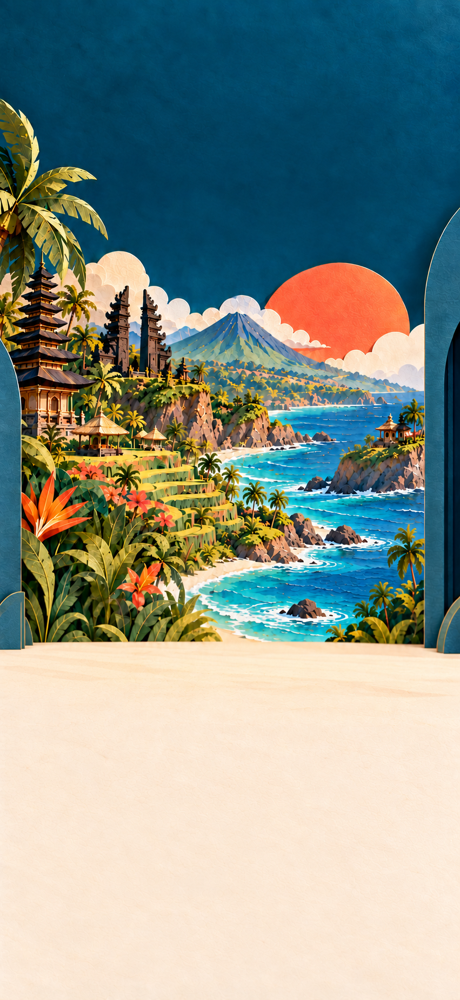

# Travary destination art: expansion guide

Created 5 October 2026 after approval of the connected Travi onboarding. This is the working guide for every destination we add. The [asset register](onboarding/DESTINATION_ART_REGISTER.md) tracks what exists, what needs generating and what has reached the app; its [JSON ledger](onboarding/destination-art-registry.json) holds the paths and place selectors.

**Country-first coverage is the owner's decision (5 October 2026). Generate one broad scenic stage per country as the default, covering the cities and regions selected within it.** City/region-specific stages are optional selected additions, not a prerequisite for supporting those destinations. Keep the existing Bali and Kyoto prototype scenes as exceptions. Travi, his performance, the theatre reveal, headline, date tags, folio interaction and pass presentation are shared. A destination-specific video is not required.

**9 October 2026 art update:** All [31 requested stills](mockups/onboarding-art-requests-2026-10-09/README.md) now exist: 24 country stages, a place-neutral Anywhere fallback, prop-free Kyoto and five shared green foreground drafts. New owner approval and native integration are pending. Singapore reuses its already integrated city stage; the 30 authorized city overrides are already bundled. The green drafts need colour cleanup and foreground registration validation before the shared films. This current status supersedes the historical queue descriptions below; use the register for actual coverage.

## The visual reference

Use the **clean Bali plate** below as the authoritative layout/material reference, and the chosen place's own artwork as the content reference. Kyoto is the second example of the same stage architecture with a different landscape. Preserve the richness and scale: the destination fills the theatre, rather than sitting in a small framed postcard.

**Folio-scene preparation, 6 October:** the [prop-free Bali reference](mockups/onboarding-folio-motion-v1/bali-stage-prop-free-v1.png) and [matching closed folio cutout](mockups/onboarding-folio-motion-v1/closed-folio-v1.png) now exist for the [native motion rehearsal](mockups/onboarding-folio-motion-v1/README.md). Use the prop-free reference for future country plates. The older plate below remains the approved scene-layout history and contains the closed folio and loose tickets. Keep both folio states/tickets in shared foreground layers so one country plate works throughout the story; the old Kyoto prototype still needs prop separation during integration.



[Bali in the live interface](mockups/onboarding-journey-v1/journey-bali-preview-v1.jpg) · [Kyoto clean stage](mockups/onboarding-journey-v1/kyoto-stage-v1.png) · [Shared transparent Travi](mockups/onboarding-journey-v1/travi-cutout-v2.png) · [Exact selected generation prompts](mockups/onboarding-journey-v1/PROMPTS.md).

## What to generate for each place

| Asset | Needed for this onboarding? | Specification |
|---|---|---|
| **Clean country stage** | **Yes: one per country in the baseline scenery library** | Portrait RGB PNG master; current approved reference is **851 × 1848**. Same camera, theatre wings, lighting and floor. No character, lettering or UI. |
| City/region-specific stage | Optional selected exception | Same contract; generate only when explicitly prioritised. It is not required for each city a traveller can select. |
| Destination reference/brief | Yes as an input; reuse what exists | The place's own postcard or approved reference, plus a short list of correct architecture, landscape, vegetation and season. Log source paths and geographic scope. |
| Separate scenery layers | Optional, when a planned effect needs them | Authored foreground/middle/background pieces with alpha and coherent alignment. A flat plate cannot supply independent parallax or unfolding buildings. |
| Destination video | No | Reuse the shared reveal and Travi performance. |
| New Travi, ticket buttons or date labels | No | Reuse shared character assets and live native components. |

If the place is also being added to the wider product, check its **countdown postcard** (1122 × 1402), **Trips postcard** (1536 × 1024) and optional **Documents destination stamp** (1024 × 1280). These are separate compositions for their own screens, described in [ART_PACKS.md](ART_PACKS.md). They are not additional onboarding requirements. Existing postcards can guide a new stage, but their borders, aspect ratios and quiet zones prevent simply stretching them into the onboarding background.

## Composition contract

The current reference is a tall portrait, approximately **0.4605 width / height**. Preserve that layout when requesting a larger master; export dimensions must be measured rather than assumed. Production renditions and device cropping remain an integration decision.

| Zone, measured from the top | What belongs here |
|---|---|
| **0–27%** | Quiet petrol-teal paper sky, especially through the centre, for the wordmark and two-line live headline. Side foliage may frame it; detailed landmarks must not compete with the words. |
| **About 27–65%** | Rich, expansive destination scenery: dimensional folded cardstock, recognisable local shapes, layered depths, warm light and fine paper grain. Fill the stage edge to edge. |
| **About 65–100%** | Warm cream stage/control floor. Keep the lower centre calm for date tags, departure tag and the primary button. Match the reference floor and allow shared folio/ticket props at lower left; future country plates keep those props separate. |
| **Right foreground, roughly 42–71%** | Space for the shared transparent Travi pose. Do not paint a character, wheels or a character shadow into the background. The landscape continues naturally behind him. |

These are composition guides for the current prototype, not fixed production UI coordinates. Check short/tall phones, safe areas, larger text and an open keyboard before final integration.

Keep the cream, navy and teal anchors, coral accent and warm physical light. Let each destination have its own scenic colours: snow, city stone, autumn foliage and tropical water should retain their identity. Do not tint every destination into Bali. Keep the same paper craft and camera so Travi belongs in every scene.

## Reusable generation brief

Use built-in imagegen for a new bitmap stage, referencing **both** the clean Bali template and the destination's own content reference. Inspect both references first. Fill every bracket below before submitting, then retain the exact final prompt and selected output path.

```text
Use case: compositing.
Asset type: clean [DESTINATION] scenic stage for Travary onboarding.

Input 1 is the approved clean Bali stage. It is the authoritative reference
for portrait proportions, camera, quiet teal sky, theatre wings, cream floor,
lighting and dimensional paper material. Remove any baked-in folio or loose
tickets from the template; those will be shared foreground props.
Input 2 is [COUNTRY REFERENCE PATH]. It is the content reference for
[COUNTRY, INCLUDING COUNTRY CODE]. Country is the default scope. Specify a
city/region only when this asset is an explicitly chosen exception.

Replace only the destination landscape with a rich layered-paper world of
[DESTINATION]. Include [CORRECT LANDMARKS / ARCHITECTURE / LANDSCAPE / PLANTS],
with [CHOSEN SEASON AND LIGHT]. Remove the input postcard's border.
Keep the destination expansive across the middle stage, never inside a
small frame. Preserve the quiet central upper sky, the floor boundary at
about 65% of the portrait, clean lower control floor and reference camera.
Preserve the reference's tactile folded cardstock, fine grain and warm light.

The new place must have its own identity. Do not retain Bali's temples,
volcano, rice terraces or tropical coastline unless they actually belong
to this destination. Keep all text areas calm and the right foreground
available for a separately composited character.

Output one complete clean portrait scenery plate, matching the reference
layout and aspect ratio. No character, character shadow, text, place label,
folio, loose tickets, UI, dates, button, logo, flag, watermark or device frame.
No glossy plastic.
```

## Coverage beyond the first two places

The connected browser prototype and [first native integration](ONBOARDING_NATIVE.md) resolve Bali and Kyoto; other names use the neutral workshop until their country plate exists. The repository has **30 place packs with postcard references: 25 countries, three cities and two regions**. The next baseline art queue is **25 country stages**. The two existing Bali/Kyoto stages are integrated selected-place exceptions; the remaining three specific-place gaps are **deferred optional additions**, not required coverage work. This is a local file inventory, not proof of remote publication or installation.

For production, map a selected city/region to its country and use that country's stage by default. This does not change the traveller's destination label: their chosen city remains live text, while the art represents its country. If a deliberately selected specific-place stage already exists, it may override the country scene. The optional override lookup can follow the product's existing structure:

1. Exact **city** plus country.
2. Matching **region** plus country.
3. A geographically and visually appropriate **country** stage.
4. The shared **place-neutral workshop** when no suitable stage is available, offline or loading fails.

Lookup precedence is not generation priority: **build country coverage first; do not turn the city/region override slots into a city-by-city generation backlog.** The traveller can still choose any supported destination and continue. Artwork availability must not block holiday setup. A broad country scene is a symbolic country composition, not a claim to depict the selected city's exact view. Compose it to suit broad country coverage; use neutral scenery when it conflicts with the selected place. Never relabel Kyoto-specific art as Tokyo or Bali-specific art as another country. Ambiguous or unverified place input uses the neutral stage until identity is resolved.

Reuse the product's country/region/city conventions, with country codes attached to region/city selectors. Avoid growing a hard-coded list of free-text name matches. The proposed stage key is **`onboarding_stage`**; it has not been wired into the app or published in the existing packs. Guest access also needs a deliberate delivery path: current downloadable packs require signed-in Storage reads, so onboarding must have bundled fallback art and a guest-compatible way to load extra stages. Do not assume the existing signed-in pack downloader already covers this flow.

## Shared image queue as the story grows

These are reusable across **all** destinations; track them once in the register.

| Next story beat | Image work to brief | Current state |
|---|---|---|
| Arrival and destination | Entrance/idle keyframes and films; excited transparent coral spinner | Existing prototype assets |
| Booking folio | An **open navy folio shell** with blank paper/ticket spaces; a separate Travi **offering/receiving a booking** pose | Generated; [stills pending owner approval](mockups/onboarding-booking-folio-v1/README.md) |
| Folio transition | Matching closed folio cutout and a prop-free stage reference; future country plates use separate foreground props | Prepared for motion review; hinged rig and production integration remain |
| Detail review | Travi **checking a ticket attentively**, with the same identity and scale | To brief; all actual booking details stay live UI |
| First itinerary day | Travi **proudly presenting the organised folio** | To brief; the actual itinerary remains real UI |
| Pass invitation | Reuse the folio/presentation pose initially; new artwork only if the reviewed composition needs it | Not a required separate art set yet |
| Richer destination motion | Separate face/hand/wheel rig pieces and scenic depth layers | Optional production enhancement, not a blocker for coverage |

Do not generate the entire shared queue speculatively. Brief each asset against its real interaction and approved layout as that beat is built. An attentive face, a useful gesture and a proud handoff should express different jobs rather than repeating the same celebratory pose.

## Adding a destination and keeping the log current

1. **Check country coverage first, then add a ledger entry if art is needed.** A new city under an already-covered country needs a place-to-country mapping, not another generated stage. Record canonical ID, label, country/region/city selectors, geographic scope, coverage tier and reference paths. New countries without an existing pack can be added; the current 30 rows are an inventory, not a permitted-destination list.
2. **Record the gap and tell the owner.** For example: “France needs one clean country stage; its postcards already exist. Paris and other French destinations can use it. Travi and the video can be reused.” City/region art remains deferred unless specifically prioritised. Add any genuinely necessary shared asset to the shared queue, with its story beat.
3. **Generate and retain provenance.** Keep the editable/PNG master and the exact prompt, input references, generation mode and selected source path. Stage new masters under `art_packs/pending/onboarding/<destination-id>/onboarding_stage_v1.png` until integration; pending art is not built or published. Current prototype assets retain their existing paths.
4. **Review in the live composition.** Check geography, template alignment, character clearance, lighting, no baked-in UI/character, readability, floor continuity, reveal/idle, neutral fallback and reduced motion. Review actual destination selection rather than only the image in isolation.
5. **Update status and owner-facing register.** Use `needed → generated → review_ready → approved → integrated → published`, recording the relevant paths and evidence at each change. Existing Bali/Kyoto use `prototype_ready`: that does not imply Flutter integration. A copied file is not a published pack.
6. **Integrate deliberately.** Add the future `onboarding_stage` contract, resolver and delivery path; measure dimensions and encode suitable delivery renditions. Update pack manifests/build versions and the app only as part of that integration task, following [ART_PACKS.md](ART_PACKS.md). Preserve originals.

**Working rule for subsequent onboarding work:** keep this guide's register and JSON ledger in sync whenever a destination or shared image requirement changes, and mention newly needed images in the user update. No background monitoring or automatic generation is implied.

Prioritise countries using actual upcoming destination additions or observed demand, starting from the 25 existing country references. Paris, Orlando and the Lake District retain their reference rows but are deferred optional scenic additions. Do not commission a separate image for every city. New city/region selections should benefit from their country's coverage.
