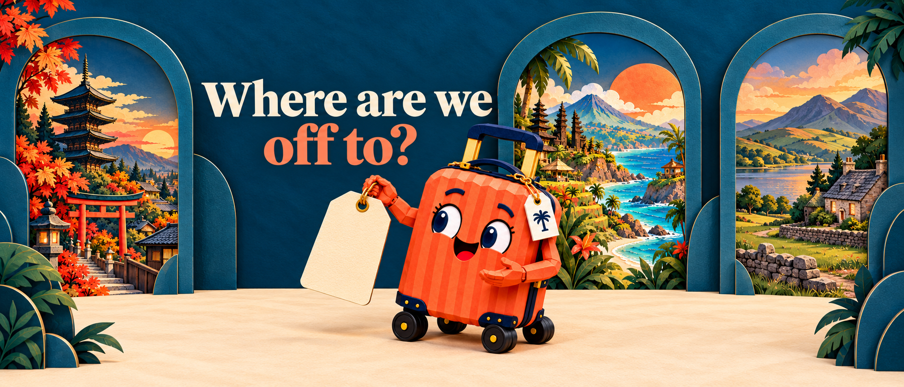

# Travary App Store creative concepts v1

18 October 2026. The owner approved both scene stills: “yes! They are beautiful.” Generated with built-in ImageGen using existing Travary artwork and authentic app captures as references. Scene composition approval is recorded; new acting/transition keyframes and final store exports remain to be reviewed.

The owner prefers animating Travi independently and compositing him onto these backgrounds. The delivered first pass reuses existing footage with local Pillow/FFmpeg composition. No new provider job was submitted. See [the layered production plan](MOTION_PLAN.md).

## Current delivery: header v4 and search v5, loop revision 2

[Open the layered still/acting review](review/index.html). Both compositions now have countdown text, genuine app UI where applicable, isolated existing Travi frame samples, and layouts adjusted to Apple's actual art safe areas. The owner requested the complete header image inside the safe area, as for search: header v4 now keeps all three destination windows, the lettering, Travi and his countdown together inside that area. The original concepts below remain approved scene references. The owner approved the corrected search v5 and continuing local reuse on 18 October: “much better, lets go ahead and do the rest”.

The owner approved header v4's still composition (“awesome, looks great!”) and requested a cleaner cream search background, because the enlarged linen looked soft/coarse at zoom. Search v4 matched the screenshot cream tone and composed lettering/genuine UI directly at 3840 × 2560. No new generation was used for that material revision. The owner then flagged rough edges in a native tag close-up: the manual matte retained background, and the unpadded shadow was clipped at its canvas boundary.

Search v5 regenerates only the postcard, blank tag and twine as a real transparent asset with built-in ImageGen, preserving the raw generated source and [exact extraction prompt](prompts/search-postcard-alpha-v5.txt). The derived cutout removes only near-invisible alpha residue, retains antialiasing and adds crisp editable type. Shadows now have generous transparent padding and zero alpha on every outer boundary. The cream backdrop, headline, genuine phone UI and Travi are retained. That still-art correction required no new Travi/video generation. The subsequent approved local assembly uses the same corrected asset.

- Header: [finished still](review/header-start-v4.png), [art safe-area detail](review/header-safe-area-detail-v4.png), [acting storyboard](review/header-reuse-storyboard-v4.jpg). Existing `tag-idle` footage. [Previous header comparison](review/header-safe-area-detail-v3.png).
- Search: [finished still](review/search-start-v5.png), [art safe-area detail](review/search-safe-area-detail-v5.png), [native tag close-up](review/search-tag-closeup-v5.png), [acting storyboard](review/search-reuse-storyboard-v5.jpg). Existing `present-idle` footage. [Previous cutout comparison](review/search-safe-area-detail-v4.png).
- [Official template bounds and source hashes](references/apple-safe-areas.json). The complete header theatre is proportionally fitted inside these bounds, with navy-wall/cream-floor texture continuing outside it; search objects are recomposed centrally. These are inspection guides, not exact simulations of every store placement.
- [Local compositor](tools/compose_reuse.py) prepares stills by default. Its `--video` mode uses existing keyed frames and local ffmpeg only, after approval. No Scene Studio/Replicate submission code is present in it.
- [Complete-header compositor](tools/compose_header_safe.py) prepares header v4 and its storyboard without new image or character generation. [Header v4 geometry/QA report](review/header-reuse-report-v4.json) verifies that the whole scene bounds fit the safe area and the start/end stills are pixel-identical.
- [Clean-search compositor](tools/compose_search_clean.py) prepares search v4 from the existing fine paper, postcard, phone/capture and isolated Travi. [Search v4 report](review/search-reuse-report-v4.json) records the cream reference, paper source, authentic capture and final-size still hashes. [Search v4 QA](review/search-qa-report-v4.json) records containment, format and loop-end checks.
- [Corrected alpha compositor](tools/compose_search_alpha.py) prepares v5 from the [raw ImageGen cutout](layers/search-postcard-tag-source-v5.png), [derived clean asset](layers/search-postcard-tag-clean-v5.png), [lettered asset](layers/search-postcard-tag-lettered-v5.png) and independently padded shadows. [V5 composition report](review/search-reuse-report-v5.json) and [edge QA](review/search-qa-report-v5.json) record the repaired boundaries and preserved app/character pixels.

V5 verification also repaired a metadata-write mistake in the old full-size v4 start PNG, restoring it exactly from the preserved, hash-identical end frame. The recovered metadata is retained in [recovered-manifest-v4.json](review/recovered-manifest-v4.json). Every listed image was decoded and hash-checked after the final manifest write. Keep metadata output paths distinct from asset paths when updating this pack.
- [Composition report](review/reuse-report-v3.json). V2 files are retained as earlier fit studies and are superseded by v3. These older studies are retained for comparison; the current composed delivery is listed above. No placement upload or new character generation has occurred.
- [QA report](review/qa-report-v3.json): all 194 isolated source frames fit the verified art safe areas; both start/end composites are pixel-identical; all eight review stills are opaque RGB with verified hashes; the real UI is fitted proportionally without cropping. The current playback report above supersedes this preparation-only QA record.

The owner authorized continued work on 18 October, with consultation required for any new paid Travi generation. Existing footage fits these proposed layouts, so no new paid clip is currently necessary. Normal assistant/image tool usage is separate from video provider charges.

Both loops are now rendered and checked: **7 seconds, 30 fps, H.264 MP4, silent**, with matching opaque RGB PNG fallbacks. The header is 3840 × 1646; search is 3840 × 2560. The original 8.1-second pass is preserved for comparison. The current repair removes the five mismatched endpoint-fade frames at each end, registers the unblended performance to the approved size with one constant transform, and overlaps three matching-pose frames. Each 84-frame cycle is 3.5 seconds at 24 fps; two repeats convert exactly to 210 frames at 30 fps. This corrects the join without introducing a new scene transition. Lettering, app UI and scenery stay steady; Travi and his held header tag move.

- [Play both loops](review/index.html) using the art-safe detail or full canvas views.
- [Header video](exports/travary-header-v4-loop-v2.mp4) and [header still](exports/travary-header-v4.png).
- [Search video](exports/travary-search-v5-loop-v2.mp4) and [search still](exports/travary-search-v5.png).
- [Delivery manifest](exports/delivery-manifest.json) records dimensions, durations and SHA-256 hashes. [Playback and scale QA](review/motion-qa-report-v2.json) records full-file decoding, frame rate, exact preservation of pixels outside the character, join-window geometry and wrap motion against the performance's normal frame changes. Endpoint equality alone missed the old size pulse. [Repair script](tools/repair_loop_scale.py) and [packaging script](tools/package_repaired_motion.py) reproduce the current loops and checks; the earlier compositor video modes reproduce the archived first motion pass.

Visual QA also removed tiny detached source/matte remnants in fourteen presenter frames (at most 60 source pixels), including a brass fleck beside the waving hand. The connected character and its antialiasing are retained. The owner flagged a zoom in/out at the old joins. The source-size range around the join is now 0 pixels for the header (previously 12) and 1 pixel for search (previously 11), on the isolated source camera. Remaining gesture movement is preserved. Final playback and actual App Store Connect placement review remain owner checks before upload. The scene and existing-performance assembly are approved; final playback is not yet recorded as approved. No upload has been performed and no new paid character/video job was submitted.

## Header: holiday anticipation (original concept)

The navy workshop opens onto Kyoto, Bali and the Lake District. Travi presents a blank luggage tag beneath “Where are we off to?”. The tag is intentionally blank so crisp countdown words/numerals can be added independently in the final composition.

- Native output: 1915 × 821 RGB PNG; close to the intended 21:9 placement.
- [Exact prompt](prompts/header-anticipation-v1.txt).
- Inputs: workshop and Kyoto stages, Bali PNG master, original Travi passport identity source (passport omitted), style board.
- Proposed motion to storyboard after scene review: a small anticipatory glance at the tag and a warm presenting gesture, with restrained scenery depth. This initial acting proposal preceded the approved existing-footage reuse pass; no new transition was introduced.

## Search: the organiser's product benefit (original concept)

“Your holiday, sorted into days.” pairs a Lake District postcard and Travi with a large phone reserved for the real Today capture. The green phone and blank tag are deliberate compositing placeholders; they are not proposed final search content. The authentic app screen must be inserted from captures/01-today.png without generative redrawing, and any countdown type stays independent of the artwork.

- Native output: 1536 × 1024 RGB PNG, 3:2.
- [Exact prompt](prompts/search-day-plan-v1.txt).
- Inputs: style board, existing Travi present pose, genuine Today and countdown captures as content/scenery references only.
- Proposed motion to storyboard after scene review: Travi connects the postcard/countdown to the ordered day with one readable gesture. App content and lettering remain crisp composite layers; the scene works silently. This initial concept preceded the approved existing-footage reuse pass.

## Production status and remaining review

Scene/layout and reused performances are approved. Final-size lettering, authentic UI, safe-area fitting and local video assembly are complete. Full playback decode, supported format/duration and loop-join checks have passed. The review contains final motion plus still details. Review the finished loops and the localized actual placements in App Store Connect Preview before upload. Any newly proposed scene transition or paid Travi performance needs separate consultation and artwork/keyframe approval under [AGENTS.md](../../../AGENTS.md).

[Apple creative specifications](https://developer.apple.com/help/app-store-connect/reference/app-information/creative-assets-specifications) were rechecked on 18 October 2026; the delivery files match the listed dimensions, frame rate and duration. The original concept PNGs above are preserved references. No conversion uplift is claimed.

## Screenshot handoff resolved for planning

The [proposed main screenshot set](../../app-store/PROPOSED_SCREENSHOT_SELECTION.json) includes frame 11's widget and omits frame 05's flight-entry demonstration, retaining all eleven files as usable source/alternate assets. The owner has not confirmed this selection for upload.

Frame 04's cream lower half is accurate Smart Import loading UI. The proposal keeps the current real capture. The simulator's 8:20 status-bar override remains in place until any required app recordings are complete; this task did not clear it.

All assets and prompt paths, dimensions and hashes are in [manifest.json](manifest.json). Other ongoing work, screenshots, captures and app code were preserved.
