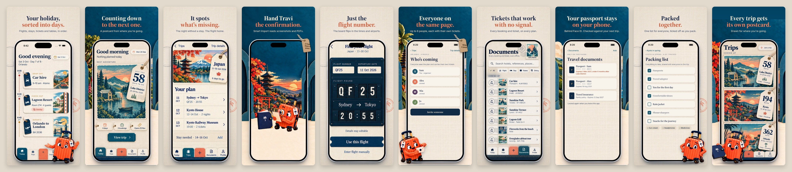

# App Store screenshots v1: reference pack for ChatGPT

16 October 2026. Ten App Store screenshots in Travary's travel-ephemera look,
laid out here with exact geometry and the app's real fonts, for ChatGPT's image
generation to finish. The listing plan they belong to (story, captions, header
and search assets, metadata) is [docs/APP_STORE_LISTING.md](../../APP_STORE_LISTING.md).



## The direction (owner, 16 Oct 2026)

- **One phone, centred, the same in every frame**: a Silver iPhone 17 Pro Max,
  straight-on, outer edge x 130–1190, y 590–2809 on the 1320 × 2868 canvas
  (`frames.json`). The earlier storyboard's phones varied in size and position.
- **Less empty space**: a bigger phone, a bigger headline, and the app's own
  art behind it (linen with postmarks tucked behind the phone, or Travi's
  workshop wall with a destination in the arches).
- **Travi overlaps the phone**, standing in front of its lower corner, in
  frames 01, 06, 09 and 10. He's inside the app screen in 02 and 04. He stays
  off tickets, flight data and passports (03, 05, 07, 08), as in the app.
- Linen and navy frames alternate; headlines in Source Serif 4 Bold with the
  second line in coral ("Paper words"), the line under it in Inter.

## What's here

| Path | What it is |
|---|---|
| `PROMPTS.md` | The series brief and one prompt per frame, ready to paste, plus fixes and a header prompt |
| `references/green/NN-*-green.jpg` | The image ChatGPT edits: each frame with the screen in flat green #00B140 |
| `references/layout/NN-*.jpg` | The same frame with a stand-in screen, to show intent |
| `references/travi/travi-*.png` | Travi's approved poses, cut out (folio removed except in "wave") |
| `references/style/style-board.jpg` | Palette, type, materials, Travi and the rules on one board |
| `references/contact-sheet.jpg` | All ten layouts in a row, for keeping the set consistent |
| `references/screens/` | The stand-in screens (design mockups and placeholders, not the real app) |
| `frames.json` | Geometry, captions, backgrounds, Travi's poses and placements |
| `layout.html`, `render_layouts.js` | Draw the references (and final frames from captures) |
| `compose.py` | Puts a real simulator capture into ChatGPT's green screen |

## Running the ChatGPT session

1. Start a ChatGPT Project ("Travary screenshots"). Add the style board,
   contact sheet and the four Travi poses as project files.
2. Send the **series brief** from `PROMPTS.md` with its attachments. Wait for
   the confirmation.
3. Send **frame 01** with its three attachments. Iterate with the fixes in
   `PROMPTS.md` until it passes the checklist below. Download it as
   `chatgpt/01-today.png`.
4. Frames 02–10: same, and attach the approved frame 01 to each as the style
   anchor. Save each as `chatgpt/NN-<slug>.png` (slugs are in the file names
   under `references/green/`).
5. Look at all ten side by side before going further: the phone, light and
   type should match across the set.

### Check every frame for

- [ ] The words exactly as given: spelling, apostrophes, line breaks, nothing extra.
- [ ] The phone in the same place and size as the green layout, straight-on.
- [ ] The screen flat green to its rounded edges; the Dynamic Island black.
- [ ] Travi on-model (coral ribbed shell, navy handle on brass posts, palm tag)
      and only in 01, 06, 09, 10, not covering the upper two-thirds of the screen.
- [ ] No logos, prices, badges, brand names, people or extra devices.
- [ ] Frames 04 and 06 keep their kraft tags ("2 free, then a pass", "With a pass"):
      Apple 2.3.2 asks screenshots to say when a feature needs a purchase.

## Putting the real app in

App Store screenshots must show the app as it is (Apple 2.3.3), and image
models redraw interface text wrongly, so ChatGPT never draws the screen.

1. Capture each screen in the iPhone 17 Pro Max simulator (1320 × 2868) by
   the shot list in the listing plan, and save it as `captures/NN-<slug>.png`
   (for example `captures/01-today.png`).
2. Composite:

   ```bash
   cd docs/mockups/app-store-screenshots-v1
   python3 -I compose.py --all
   ```

   Each `chatgpt/NN-*.png` gets its matching capture under its green screen
   (Travi and the tags stay on top) and lands in `final/` at 1320 × 2868, plus
   a `_1206x2622` copy for the 6.3-inch slot that App Store Connect requires.
   One frame at a time: `python3 -I compose.py chatgpt/01-today.png captures/01-today.png final/01-today.png`.
   It refuses an image that isn't the App Store shape and warns when ChatGPT's
   screen has drifted from the capture's shape.
3. Check `final/` at full size, then upload.

**Without ChatGPT:** these layouts are store-ready on their own.
`node render_layouts.js --final` draws every frame that has a capture in
`captures/` into `final/` at 1320 × 2868 (resize for the 6.3-inch slot with
`sips -z 2622 1206`).

## Rebuilding the references

```bash
cd docs/mockups/app-store-screenshots-v1
npm i playwright        # once, or PLAYWRIGHT=/path/to/node_modules/playwright
node render_layouts.js
```

Edit captions, backgrounds and Travi's placement in `frames.json`; the
phone's geometry is shared by every frame. It needs network access for Google
Fonts. The stand-in screens come from `docs/mockups/` (time rail, countdown,
C2 ledger, documents stamps, Trips postcards); the Smart Import one is the
Kyoto stage with Travi's reading pose. They contain design-mockup details
(the demo's "Alamo" hire car, for one) that the real captures replace.
