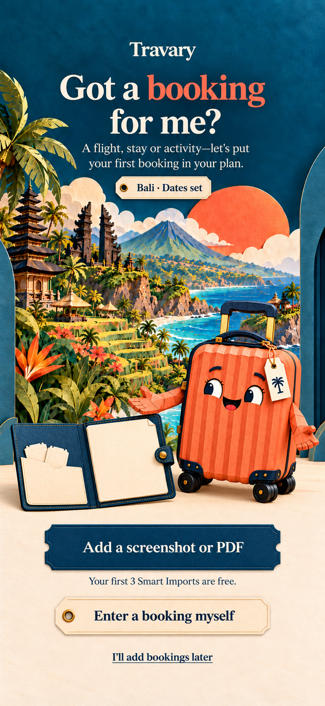

# Got a booking for me? — still art for approval

5 October 2026, updated 6 October. The owner authorised generating this scene, liked the results, and requested a transition rehearsal before more film. **Art direction accepted for the motion study; production performance remains under review. No new video has been rendered.** See the [interactive folio focus and flight-board choreography](../onboarding-folio-motion-v1/README.md).

## Review the images

Open **http://127.0.0.1:55371/** for the full scene and the two transparent assets displayed on cream. [Saved review gallery](folio-art-review-v1.jpg).

| Selected image | Purpose | Dimensions |
|---|---|---|
| [folio-opening-screen-v1.png](folio-opening-screen-v1.png) | Complete opening-screen composition for approval, including proposed copy and three choices | 851 × 1848, RGB |
| [open-folio-v2.png](open-folio-v2.png) | Open navy folio with blank cream booking surface, transparent background | 1536 × 1024, RGBA |
| [travi-receiving-v1.png](travi-receiving-v1.png) | The selected coral spinner inviting a booking, transparent background | 1254 × 1254, RGBA |



Travi's viewer-left hand presents the folio, with his other hand giving a quieter welcoming gesture. His open eyes and cheerful smile retain the approved character. The open folio replaces the previous closed folio rather than adding a second one. Its cream right page stays blank for real booking UI. The full Bali paper world, cream floor and departure-tag motif continue from the previous scene.

The headline is **Got a booking for me?**, with **booking** in coral. The three choices are **Add a screenshot or PDF**, **Enter a booking myself** and **I'll add bookings later**. The opening does not claim a booking has been imported or saved.

The illustrated **Bali · Dates set** tag and **Your first 3 Smart Imports are free** line are composition examples. Production must use actual destination/dates and the remaining allowance. The full PNG has baked-in text and controls; it is an approval mockup, not an animation input or live interface. The scene image re-renders the supplied props into the full composition; it is not a pixel-identical compositing of the separate PNGs.

## Generation and inspection

All three selected files were created with **built-in imagegen** and copied unchanged into the project. [PROMPTS.md](PROMPTS.md) contains the exact prompts and reference roles, including the initial folio and its targeted transparency refinement. [generation.json](generation.json) records generated-source paths, workspace paths, dimensions, alpha inspection and checksums. Original generated files remain in the Codex generated-images folder; the unselected initial folio remains there.

The folio has real alpha spanning **0–254**, with **34.45%** fully transparent pixels; Travi has alpha **0–255**, with **52.44%** fully transparent pixels. All four corners are fully transparent for each. Browser review confirmed both props composite cleanly on cream, without a visible coloured background. RGB values outside transparent areas can still appear in viewers that ignore alpha; the assets' actual alpha is authoritative.

Visual review checked character identity, complete handles/hands/wheels, a single folio and mascot, blank paper spaces, paper material/light, scenery continuity, copy accuracy and complete control margins. The review page loaded all three images and its console showed no captured errors or warnings. These are art/browser checks, not native UI, import or animation validation.

## After the owner's approval

The next performance connects the completed date tag to **folio enters → opens → Travi offers it → waiting state**. Text and controls remain live; do not send the full rendered UI mockup into a movie generator.

A matching [closed folio cutout](../onboarding-folio-motion-v1/closed-folio-v1.png) and [prop-free Bali stage reference](../onboarding-folio-motion-v1/bali-stage-prop-free-v1.png) were prepared on 6 October for the motion study. The older Bali/Kyoto plates include a closed folio and loose tickets, so reusing them unaltered behind a new moving prop would leave a duplicate. These shared assets are logged in the [continuing asset register](../../onboarding/DESTINATION_ART_REGISTER.md). Future country plates should use the same stage layout with those props kept separate, preserving one base scenery image per country. Kyoto's older plate still needs prop separation when that branch is integrated.

The current props are whole images, not an articulated rig. Genuine cover/page unfolding or independent hand/eye acting needs deliberately authored pieces or a suitable performance asset. The [scene brief](../../ONBOARDING_BOOKING_FOLIO.md) ties the later reading, review and save reactions to real operation states.

## Reopen locally

From the project root:

```sh
python3 docs/mockups/onboarding-intro-v1/serve.py --port 55371 --directory docs/mockups/onboarding-booking-folio-v1
```

This is a static art-review page. Its image buttons are illustrative; it does not import, save, purchase or change the Flutter onboarding. Countries remain the primary scenery queue, with the existing Bali/Kyoto prototypes as selected exceptions.
