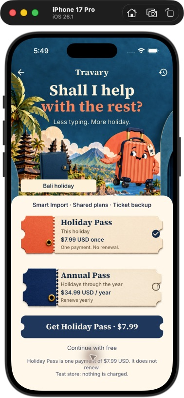

# “Shall I help with the rest?” — review v1

6 October 2026. Built-in imagegen artwork plus an actual Flutter prototype. **Owner review pending. No new video rendered.** The [scene brief](../../ONBOARDING_PASS_DESK.md) describes placement, pricing data, coverage and the next motion work.

## Still direction

Travi proudly presents the holiday and two physical paper passes in the existing colourful world. This composition is for art review; its baked type/prices are not shipped UI. The native implementation uses independent transparent layers and live controls. The US$7.99/US$34.99 in this still reflect current repository defaults, not a decision on launch pricing.

## Actual native preview

| Capture | What it verifies |
|---|---|
| [Holiday Pass](native-holiday-pass.png) | First eligible selection, visible benefits and both actual USD prices; one-off disclosure and free continuation |
| [Annual Pass](native-annual-pass.png) | User-selected annual offer, matching action price and renewal/cancellation disclosure |
| [Back to booking](native-back-to-booking.png) | Back keeps the same saved Lagoon Retreat booking in Bali |
| [Free handoff](native-free-holiday.png) | Free opens the same real Bali holiday with that stay on 6–7 October |

These are unedited simulator window captures through computer-use controls, iPhone 17 Pro/iOS 26.1, `TRAVARY_BACKEND=demo` and `TRAVARY_PREVIEW_ONBOARDING=true`. The setup deliberately left dates unknown; the saved stay then established the actual 6–7 October booked span. No invented holiday duration was added. Purchase simulation is labelled on screen.

The native scene adapts the tall composition to actual device safe areas: Travi is smaller, benefits appear before the choices, and Terms/Privacy links sit in the scrollable paper floor. Full-size live prices and terms take priority over reproducing every pixel of the still. The holiday name is on a straight tag, not laid over the angled folio cover.

## Shared masters

| Asset | Dimensions | Use |
|---|---|---|
| [Proud Travi](travi-handoff-v1.png) | 1254 × 1254 RGBA | Independent cheerful handoff pose, all countries |
| [Coral pass shell](holiday-pass-shell-v1.png) | 2155 × 730 RGBA | Blank Holiday Pass paper; live price/scope/selection |
| [Navy pass shell](annual-pass-shell-v1.png) | 2172 × 724 RGBA | Blank Annual Pass paper; live price/scope/selection |
| [Composition](pass-desk-composition-v1.png) | 851 × 1848 RGB | Approval reference only |

Original generated files are retained. The three native asset copies are byte-identical to the review masters. Exact prompts, references and absolute source paths are in [PROMPTS](PROMPTS.md), with the shell briefs also retained in [SHELL_PROMPTS](SHELL_PROMPTS.md). [generation.json](generation.json) records hashes, alpha and review state. The stage and closed folio are reused from earlier work.

## Review and animation

Review the heading, proud expression, pass materials and scope wording in this scene before making another film. The native route/pose entrance is already finite and responds to reduced motion. Independently acted eyes/hands and a folio-straightening gesture are the next shared animation refinements; there is no per-country video queue.

Final targeted validation: **40 tests passed**; `flutter analyze --no-pub` clean. Controlled widget tests cover both purchase outcomes, cancellation/failure, restore/no-pass/failure, inherited access, booking proof and changed eligibility. The simulator walkthrough covers Back and free navigation. Production billing, Android and physical-device checks remain outstanding.
