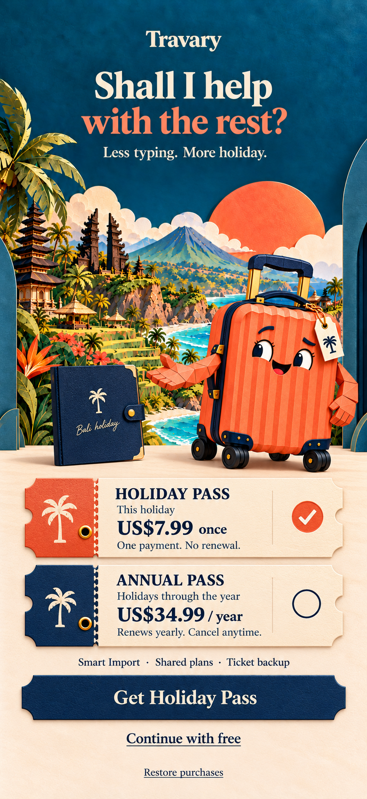
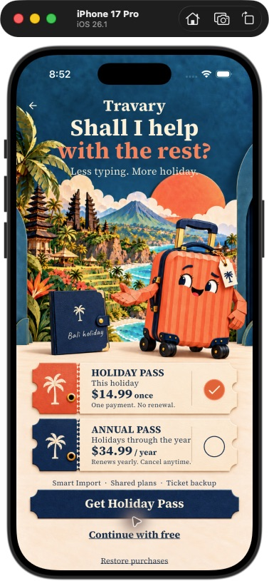

# Approved pass desk — native v2

6 October 2026. Owner approved the full composition in `approved-reference.png` and requested native fidelity, no added US prefix, $14.99 Holiday Pass and remotely changeable prices/passes. This supersedes the compact v1 native adaptation. V1 assets remain historical.

The original is reference only; its old US$7.99 price is not used. `pass-desk-art-v2.png` is the same illustrated composition with lettering, digits and selection controls removed. Flutter crops its scene, two ticket shells, blank paper and navy button at runtime, then overlays real native copy and controls. Nothing needs regenerating when a price or product title changes.

`pass-desk-foreground-v2.png` supplies the shared Travi and folio for other country stages. Bali uses the exact atlas foreground to avoid layout drift. The 25-country scenery queue remains unchanged; no destination-specific film is needed.

[Exact prompts](PROMPTS.md) · [Generation records](generation.json) · [Native behavior](../../ONBOARDING_PASS_DESK.md) · [RevenueCat configuration](../../REVENUECAT_OFFER_CATALOG.md).

## Native evidence

Flutter debug app, demo backend, iPhone 17 Pro / iOS 26.1. The first build
failed when the Mac ran out of disk space; deleting only Travary's Android
intermediate build cache freed room and the rebuilt iOS app launched.

The source composition is preserved. Native typography/selection rings sit
over blank artwork; headline spacing accommodates the notch, and live terms
use the correct regular serif face so both tickets fit on single lines.
Actions keep 44-point hit areas. Expanded remote copy and accessibility type
scroll instead of clipping. The reference omits phone system chrome.

Verified on the simulator: selected Holiday and Annual tickets, the matching
CTA name, Back preserving the saved booking, and free continuation into that
same Bali holiday with Lagoon Retreat. [Back evidence](native-back-preserves-booking-v2.png)
· [Free handoff](native-free-holiday-v2.png).

Full Flutter suite: **734 tests passed** before the final typography/spacing
polish; the final targeted onboarding/pass-desk run passed **19 tests** after that polish.
Static analysis is clean. Remote catalog behavior and purchase/restore
outcomes were tested with controlled services. No RevenueCat keys were
provided; no live catalog, transaction or production entitlement was
verified. Native pointer automation could not scroll the simulator's
ListView; widget tests verified scrolling, legal/free reachability and 2×
type. Android and physical-device QA remain.

