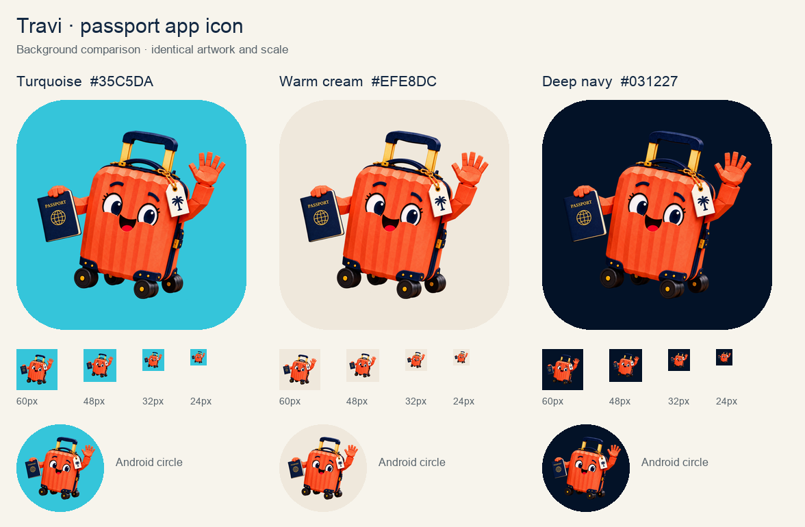

# Travi passport app icon

12 October update: the owner requested a larger top-half view for mobile readability. The [close-up revision](../travi-passport-app-icon-v2/README.md) now supplies the canonical platform files and export script. This page records the earlier approved full-body artwork; [icon-turquoise.png](icon-turquoise.png) and the original generated source preserve that version.

9 October 2026. The owner requested that the supplied waving Travi artwork become the app icon, with a passport replacing the folio. This resumes the previously parked icon work with a new direction. Created with built-in ImageGen; [exact prompt and input roles](PROMPT.md).

Travi retains the coral ribbed shell, delighted expression, wave, extended handle, wheels and palm-tree luggage tag. The folio becomes a navy passport with a gold globe. The screenshot's chroma-green background and guide lines are removed.

## Background review

The owner approved the completed turquoise passport artwork on 9 October 2026: “love it!! Let's set it as our app icon....” Turquoise blue `#35C5DA` is the selected production background. The approved artwork is applied to the iOS and Android launcher assets and the local Google Play export. Colour contrast is an art-direction judgement; conversion improvement has not been measured.

- [Turquoise](icon-turquoise.png), owner-approved production icon.
- [Warm cream](icon-warm-cream.png), `#EFE8DC`.
- [Deep navy](icon-deep-navy.png), `#031227`.

## Production assets

- [Untouched transparent generated source](../../../assets/branding/travi_passport_source.png), 1254 × 1254 RGBA.
- [Square icon master](../../../assets/branding/travary_app_icon_master.png), 1024 × 1024 RGB, full bleed with no baked corner mask.
- [Google Play listing export](../../../assets/branding/google_play_icon.png), 512 × 512 RGB.
- All existing iPhone/iPad/marketing entries in `ios/Runner/Assets.xcassets/AppIcon.appiconset` now use the passport artwork.
- All five legacy Android density icons now use the passport artwork.
- Android adaptive foreground is a transparent 432 × 432 layer, with all substantive artwork inside the central 66 dp circular safe zone on the 108 dp layer. The turquoise background is separate. XML references the padded layer directly to avoid a second inset.

To regenerate the platform assets and comparison board, run `python3 tool/export_app_icons.py` with Pillow installed. Change `BACKGROUND` in that script to select a different primary colour.

## Verification

Inspected the passport replacement, character identity, clean edges, colour comparison, 24/32/48/60 px views and Android circle previews. All 22 distinct opaque exports pass dimension and background-colour checks. The substantive adaptive foreground has maximum radius 130.6 px inside the 132 px safe circle. XML resource references and background colour match; `git diff --check` passes.

Apple's `actool` successfully compiled the asset catalog for iPhone/iPad simulator targets. Android build-tools 36 `aapt2 compile` successfully compiled the resource directory. These are resource-compilation checks; a full app build and device install were not performed for this icon.

The platform references used for export geometry are [Android adaptive icons](https://developer.android.com/develop/ui/compose/system/icon_design_adaptive) and [Google Play listing icons](https://developer.android.com/distribute/google-play/resources/icon-design-specifications). Store listings have not been uploaded. Artwork and local resource integration are complete; a device install has not been performed for this icon.
