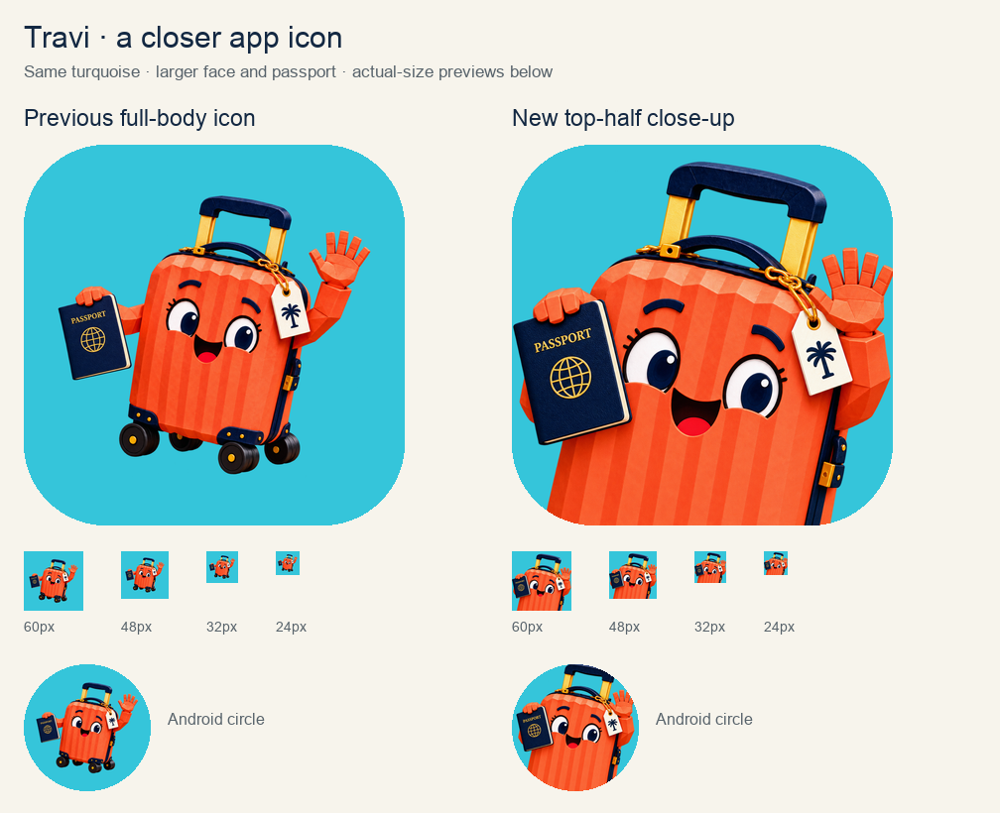

# Travi passport app icon — close-up

12 October 2026. The owner requested a much closer top-half view because the full-body mascot appeared too small on a mobile phone. This revision retains the selected turquoise `#35C5DA`, coral Travi identity and navy passport while enlarging the face and moving the passport beside it. The lower shell intentionally continues beyond the icon's bottom edge; wheels are omitted.

Created with built-in ImageGen. [Exact prompts and input roles](PROMPTS.md). The revision is applied locally to iOS, Android and the Google Play export under the owner's request; visual feedback on this new artwork has not yet been recorded as approval.

## Assets and reproduction

- [New close-up icon](icon-closeup.png), full-square opaque 1024 × 1024.
- [Canonical master](../../../assets/branding/travary_app_icon_master.png).
- [Google Play export](../../../assets/branding/google_play_icon.png), 512 × 512.
- [Square generated source](../../../assets/branding/travi_passport_closeup_source.png), untouched 1254 × 1254 RGBA.
- [Android bleed source](../../../assets/branding/travi_passport_closeup_bleed_source.png), untouched 1024 × 1536 RGBA.
- [Previous master](previous-icon.png) and [previous Android foreground](previous-adaptive-art.png), retained for comparison and recovery. The earlier full-body source remains at `assets/branding/travi_passport_source.png`.

Run `python3 tool/export_app_icons.py` with Pillow installed to regenerate the current iPhone/iPad/marketing catalog entries, five Android legacy densities, Android adaptive foreground, Google Play export and comparison board.

The square icon uses the generated crop directly, without the previous 82% silhouette fit. Android has a separate 432 × 432 transparent foreground and solid turquoise background. Its portrait is positioned 58 px from the top, resized to 272 px wide, with the extended lower shell continuing beyond the layer's bottom. The face and passport title/globe stay inside the central safe circle; peripheral handle, wave and shell may meet the mask. The foreground XML has no additional inset. This avoids shrinking the full portrait to fit its entire silhouette inside a circle.

## Verification

Inspected the close-up, navy passport, character identity, transparent edges, turquoise export, 24/32/48/60 px comparisons and Android circular mask. All 22 distinct opaque exports (master plus 21 platform/store files) have correct dimensions and match the resized master exactly. The measured critical face region and passport title/globe remain inside the adaptive 132 px safe radius (77.5 px and 125.2 px maximum corner radii respectively). Alpha and lower-body bleed checks pass. `git diff --check` passes.

Apple `actool` compiled the updated asset catalog for iPhone/iPad simulator targets successfully. Android build-tools 36 `aapt2 compile` compiled the updated resource directory successfully. The project still selects `AppIcon` on iOS and `@mipmap/ic_launcher` on Android. These are resource-compilation checks; a full app build was not performed for this asset revision.

Store upload and device installation are outside this local asset update. The earlier [9 October icon approval](../travi-passport-app-icon-v1/README.md) remains a record of the full-body version.
